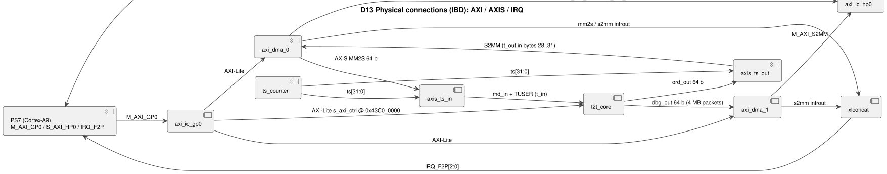
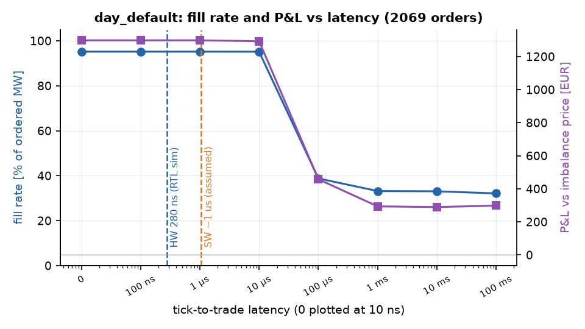
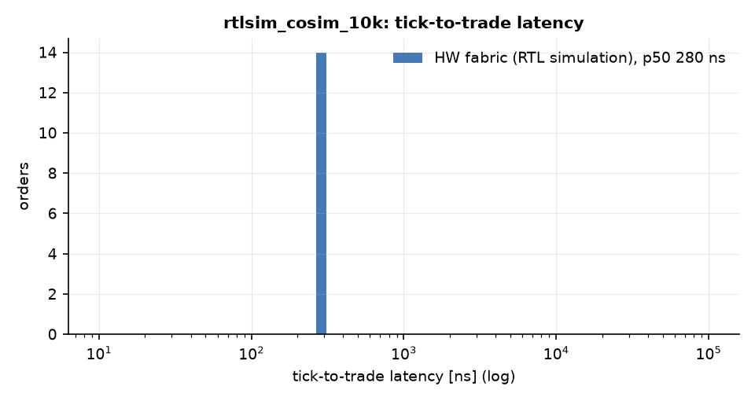

# dk1-t2t: FPGA tick-to-trade engine for the Danish DK1 intraday power market

An FPGA-accelerated tick-to-trade engine for the Nord Pool / SIDC continuous intraday market,
bidding zone DK1. A binary market-data feed is parsed, a per-product limit order book is kept
**in the fabric** of a Zynq-7010 (original Digilent ZYBO), and a fair-value taker strategy
with pre-trade risk sends IOC orders. Every order carries its in-fabric latency in clock cycles,
stamped by RTL probes. A Python golden model, the C++/HLS core and the RTL are verified
bit-exact against each other. The same C++ core also runs on the ARM as the software baseline.

```
 SD card ──► PS (Cortex-A9, bare metal) ──AXI DMA──► axis_ts_in ──► t2t_core (HLS, II=4) ──► axis_ts_out ──AXI DMA──► DDR/SD
 feed.bin     DatasetLoader, CLI, SwEngine           (t_in stamp)   parse · order table ·      (t_out stamp)
                                                                     ladder/BBO · strategy · risk
```


## Headline numbers

All from runs in this repository ([docs/08_results.md](docs/08_results.md)). **No on-board
measurements yet**: the board was not attached to the build PC, so the latency figures come from
cycle-accurate RTL simulation of the exported IP plus the timestamp probes.

| Metric | Value | Source |
|---|---|---|
| Fabric tick-to-trade latency p50 / p99 / max | **28 / 28 / 28 cycles = 280 ns** @ 100 MHz | RTL system simulation (IP + probes), every one of 351 orders on `cosim_10k` + `stress_gc_rush` (0.98 M msgs) |
| Latency jitter (no backpressure) | 0 cycles | RTL system simulation |
| Sustained input rate | 1 msg / 4 cycles = **25 M msg/s** (II = 4) | HLS schedule + RTL simulation |
| Software baseline (Cortex-A9) p50 / p99 | NEEDS-USER (board); SystemC assumes ~1.05 µs | `sw/app` SwEngine |
| Clock / timing | 100 MHz, **met post-route** (WNS +0.969 ns whole system) | Vivado 2017.2 |
| Resources (whole system, XC7Z010) | **59.5 % LUT, 60.8 % BRAM**, 43.0 % FF, 3 DSP | Vivado post-route |
| IP alone (OOC post-route) | 6 333 LUT, 32 BRAM36, WNS +1.67 ns | Vivado OOC |
| Correctness | bit-exact vs golden on all 10 datasets (csim), cosim, RTL system sim; 12 000 random sequences Python ↔ C++ | tests |



*Fill rate and P&L of the strategy's orders vs. tick-to-trade latency (simulated exchange,
`day_default`). Competitors take mispriced orders after 50 µs–50 ms, so the opportunity
disappears between 10 µs and 100 µs.*



## Honesty statements

1. The market data used for the main results is **synthetic**, generated by a documented
   agent-based model (`data/generator`). One variant (`day_eds`) is calibrated with real
   Energinet / Energi Data Service DK1 data: day-ahead and imbalance prices and wind forecasts
   for 2026-01-15.
2. Hardware latency is **in-fabric** latency, from the first beat of the triggering message
   entering the IP to the last beat of the order leaving it. It excludes DMA, DDR and any network.
   The numbers above come from RTL simulation of the implemented IP; board measurements are
   pending.
3. P&L numbers come from a simplified simulated exchange with no market impact. They illustrate
   latency sensitivity, not real profitability.

## Reproduce

Prerequisites: Python 3.11+, g++ (on Windows the MinGW shipped with CLion works), GNU make,
Java (for PlantUML); optional Icarus Verilog (RTL tests) and SystemC 2.3.4 (`make sysc`).

```bash
make setup              # .venv + Python packages
make all-offline        # datasets, golden model, pytest, C++ unit tests + csim, cross-check,
                        # PS host tests, RTL probe tests, diagrams (this is what CI runs)
make rtl-system         # RTL system simulation of the exported IP (needs Icarus + hls/ip)
make sysc               # SystemC architecture model (needs SystemC)
```

AMD tool steps (Vivado / Vivado HLS / SDK **2017.2**, tested; scripts handle paths with spaces):

```bash
make hls                # csim + csynth + IP export + OOC place & route report
make cosim              # C/RTL co-simulation on cosim_10k
make vivado             # block design + bitstream + .hdf  (hw/)
make sw                 # bare-metal application ELF       (sw/bin/)
```

Board steps (ZYBO, microSD with the dataset folders): `xsct sw/run_board.tcl`, then on the UART
run `load day_default`, `run both`. Copy the outputs back and run
`make analyze RUN=<dir> SCEN=day_default`. Details: [docs/07_implementation_zybo.md](docs/07_implementation_zybo.md).

## Design highlights

* **4-way set-associative order table** in BRAM: all four ways read in parallel, each way updated
  from its own data (no hit multiplexer on the loop-carried path); key (order id, product).
* **Two-level bitmap best-price search**: summary word → bitmap word → level quantity, with every
  word's highest/lowest set bit precomputed on write. The BBO is three dependent memory reads.
* **II = 4 line-rate pipeline** (one 32-byte message every 4 cycles at 100 MHz). It was reached
  by restructuring the core into a single `step()` with exactly one store per state element,
  using equivalent, verified rewrites; see [DECISIONS](docs/DECISIONS.md) H-1..H-6 and
  [06](docs/06_hls_model_and_verification.md).
* **Cycle-exact probes**: zero-latency AXIS pass-throughs stamp `t_in` (TUSER, beat 0) and
  `t_out` (beat 3), fed by a free-running 64-bit counter.
* **Three-way verified golden model**: Python model ↔ C++ core (12 000 random adversarial sequences)
  ↔ HLS RTL (cosim, RTL system simulation). The same C++ also runs as the ARM baseline.
* **Architecture exploration** in SystemC (all-SW / split / all-HW), trace-driven by the real datasets.

## Documentation

| Doc | Content |
|---|---|
| [01 Methodology](docs/01_methodology.md) | co-design flow, PSM view, verification ladder, references |
| [02 Requirements](docs/02_requirements.md) | actors, use cases, FR/NFR, traceability |
| [03 System model](docs/03_system_model.md) | behaviour (activities, state machines, sequences), logical blocks |
| [04 Architecture alternatives](docs/04_architecture_alternatives.md) | A/B/C allocation, SystemC results, Two-Part Architecture |
| [05 SW design patterns](docs/05_sw_design_patterns.md) | PS application and patterns |
| [06 HLS model & verification](docs/06_hls_model_and_verification.md) | golden model, C++/HLS core, verification evidence |
| [07 Implementation on ZYBO](docs/07_implementation_zybo.md) | block design, Vivado results, board procedure |
| [08 Results](docs/08_results.md) | all numbers + requirement verdicts |
| [DECISIONS](docs/DECISIONS.md) | every interpretation of the spec |
| [Report outline](docs/report_outline.md) | assignment steps → sections → evidence |
| [Protocol](proto/PROTOCOL.md) | wire format |
| SysML/UML diagrams | `docs/diagrams/*.puml` → `docs/img/D01…D18*.svg` |

Repository map: `proto/` codecs · `data/` generator, EDS fetcher, ITCH converter · `ref/` golden
model + evaluation · `hls/` C++ core, HLS top, testbenches, scripts, reports · `rtl/` probes +
cocotb tests · `hw/` Vivado · `sw/` PS application · `systemc/` architecture model · `tools/`
analysis. Progress and open items: [PROGRESS.md](PROGRESS.md).
