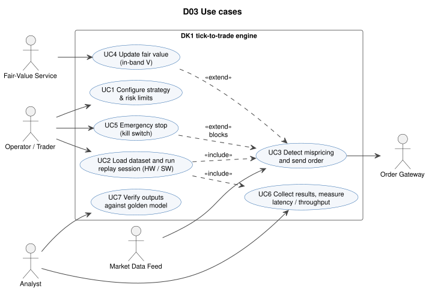
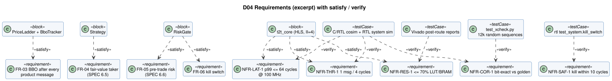

# 2. Requirements

Diagrams:  

## Actors

| Actor | Role |
|---|---|
| Operator / Trader | configures strategy and risk, runs sessions, hits the kill switch |
| Market Data Feed | simulated SIDC/DK1 exchange: A/X/E/M/S/H messages |
| Order Gateway | simulated exchange order entry: receives IOC orders |
| Fair-Value Service | slow path: publishes fair value + edge as in-band `V` messages |
| Analyst | PC tools: golden comparison, latency/throughput analysis, P&L |

## Use cases

| ID | Use case | Realised by |
|---|---|---|
| UC1 | Configure strategy & risk limits | `ConfigManager`, AXI-Lite registers, CLI `cfg` |
| UC2 | Load dataset and run a replay session (HW or SW engine) | `DatasetLoader`, `SessionController`, `HwEngine` / `SwEngine` |
| UC3 | **Detect mispricing and send order** (core real-time UC) | `t2t_core` (PL) |
| UC4 | Update fair value (slow path → in-band `V`) | generator slow path, `V` handling in the core |
| UC5 | Emergency stop (kill switch) | `CTRL.kill`, CLI `kill` |
| UC6 | Collect results & measure latency/throughput | probes, `ResultWriter`, `tools/analyze.py` |
| UC7 | Verify outputs against the golden model | `ref/model.py`, `tools/compare.py`, testbenches |

## Functional requirements

| ID | Requirement | Design element | Test |
|---|---|---|---|
| FR-01 | Parse all message types of §5.2; count and skip unknown types | `engine.hpp` step 1–3 | `test_xcheck` (unknown types, bad products), `edge_errors` |
| FR-02 | Maintain per-product L3 order table and L2 price ladder per §6 | `order_table.hpp`, `price_ladder.hpp` | `test_core` (table, ladder edges), all scenarios csim |
| FR-03 | Compute BBO after every product-affecting message | `ladder_bbo` | golden `'B'` trace bit-exact (csim, cosim, RTL sim, host tests) |
| FR-04 | Evaluate the fair-value taker strategy per §6.5 | `strategy.hpp` | `test_core.test_strategy`, hand case |
| FR-05 | Enforce pre-trade risk per §6.6 before any order leaves | `risk.hpp` | `test_core.test_risk` (all 4 reasons), xcheck coverage |
| FR-06 | Kill switch: no orders while `CTRL.kill = 1` | strategy gate | `test_core`, RTL `kill_switch` |
| FR-07 | Expose configuration and counters over AXI-Lite | `t2t_top.cpp`, `t2t_regs.h` | RTL system sim (config + STATUS over AXI-Lite), host tests (`T2tProxy`) |
| FR-08 | Emit orders in the §5.3 format with trigger seq and timestamps | `make_end`, `pack_ord`, probes | csim / RTL sim, `test_proto` |
| FR-09 | Optional debug BBO trace for full verification | `dbg_out` | all bit-exact comparisons use it |
| FR-10 | Run the identical core in SW on the ARM (baseline) | `SwEngine` | host tests (bit-exact); board run (bit-exact on 4 datasets) |
| FR-11 | Product lifecycle (PREOPEN/OPEN/CLOSED/HALT) and slot reuse | `S` handling | generator invariants, `test_core`, `day_default` (96 products on 8 slots) |

## Non-functional requirements

| ID | Requirement | Target | Verified by |
|---|---|---|---|
| NFR-LAT-1 | In-fabric tick-to-trade latency | p99 ≤ 64 cycles @ ≥ 100 MHz (≤ 640 ns); stretch ≤ 32 | RTL system sim (IP + probes), cosim; board probes |
| NFR-LAT-2 | Latency jitter (no backpressure) | max − min ≤ 8 cycles | RTL system sim; board |
| NFR-THR-1 | Sustained input rate | 1 msg / 4 cycles (25 M msg/s @ 100 MHz); minimum 10 M msg/s | HLS II, RTL sim `'Z'` record |
| NFR-THR-2 | No message loss | 0 drops on `stress_burst` | csim + host virtual board; RTL backpressure test; board |
| NFR-CAP-1 | Capacity | 8 products, 4096 live orders, 1024 levels/side/product, ±51.2 EUR window | edge scenarios, `test_core` |
| NFR-COR-1 | Correctness | bit-exact vs golden on all scenarios | `compare.py`, csim, cosim, RTL sim, xcheck |
| NFR-RES-1 | Resources (Z7-010) | ≤ 70 % LUT/BRAM; timing met at 100 MHz | Vivado post-route reports |
| NFR-ROB-1 | Robustness | malformed input never hangs the IP; every error counted | `edge_errors` (csim, RTL sim), xcheck |
| NFR-SAF-1 | Kill latency | no order for a message whose first beat arrives ≥ 10 cycles after the AXI-Lite kill write completes | RTL system sim `kill_switch` |
| NFR-DET-1 | Determinism | same input + config → identical output | seeded generator test, repeated runs |

The verdict for each requirement, with evidence links, is in [08_results.md](08_results.md#requirement-verdicts).

## Traceability matrix (requirement → design → test → result)

| Req | Design element | Test | Result |
|---|---|---|---|
| FR-01..05, FR-08/09/11 | `hls/src/core/*` | `tests/test_xcheck.py`, `hls/tb/test_core.cpp`, `tests/hand_case.py` | pass (§08 R1–R3) |
| FR-06, NFR-SAF-1 | strategy gate, AXI-Lite CTRL | `rtl/tests/test_system.py::kill_switch` | pass (§08 R6) |
| FR-07 | `t2t_top.cpp` s_axilite bundle | RTL system sim, `sw/host_test` | pass |
| FR-10 | `sw/app/engines.hpp::SwEngine` | `sw/host_test/test_sw.cpp`, board run | pass on host and on the board (bit-exact) |
| NFR-LAT-1/2, NFR-THR-1 | II = 4 pipeline, probes | RTL system sim, HLS report | pass (§08 R4) |
| NFR-THR-2 | backpressure-safe AXIS | RTL `backpressure`, csim `stress_burst`, board `stress_burst` | pass (RTL, csim, board) |
| NFR-CAP-1 | config.hpp parameters | edge scenarios | pass (§08 R2) |
| NFR-COR-1 | whole chain | csim all, cosim, RTL sim | pass (§08 R1) |
| NFR-RES-1 | HLS micro-architecture (DECISIONS H-1..H-6) | Vivado reports | pass (§08 R5) |
| NFR-ROB-1 | flat dispatch, counters | `edge_errors`, xcheck | pass |
| NFR-DET-1 | seeded RNG, integer-only core | `tests/test_generator.py::test_deterministic` | pass |
