# 3. System model (behaviour and logical structure)

## Context

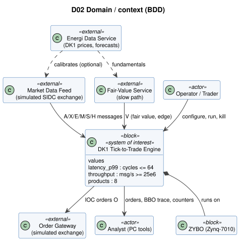

The system of interest is a tick-to-trade engine for the Danish DK1 continuous intraday power
market (Nord Pool / SIDC). It consumes an exchange market-data feed (order-level book updates
plus product state), keeps a per-product limit order book, and compares the best prices with a
fair value published by a slow path. When a resting order is mispriced by more than an edge, it
sends an IOC order through pre-trade risk. Products are quarter-hour delivery periods with
gate closure 60 minutes before delivery. Only the last two hours before each gate closure
are simulated, and at most 8 products are active at once, mapped to slots `d mod 8`.

## Behaviour

* **D05, process one message.** This is the hard real-time chain:
  parse → order table → ladder → BBO → strategy → risk → encode.
  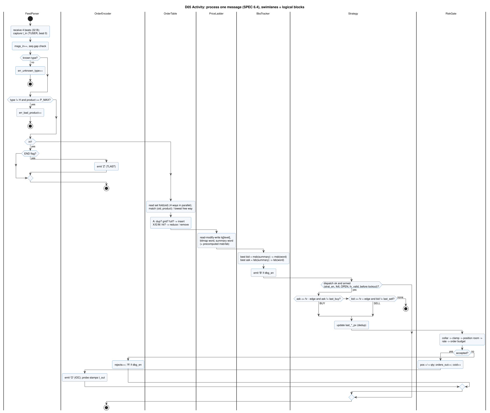
* **D06, replay session** on the PS (load, configure, run HW/SW, write results).
  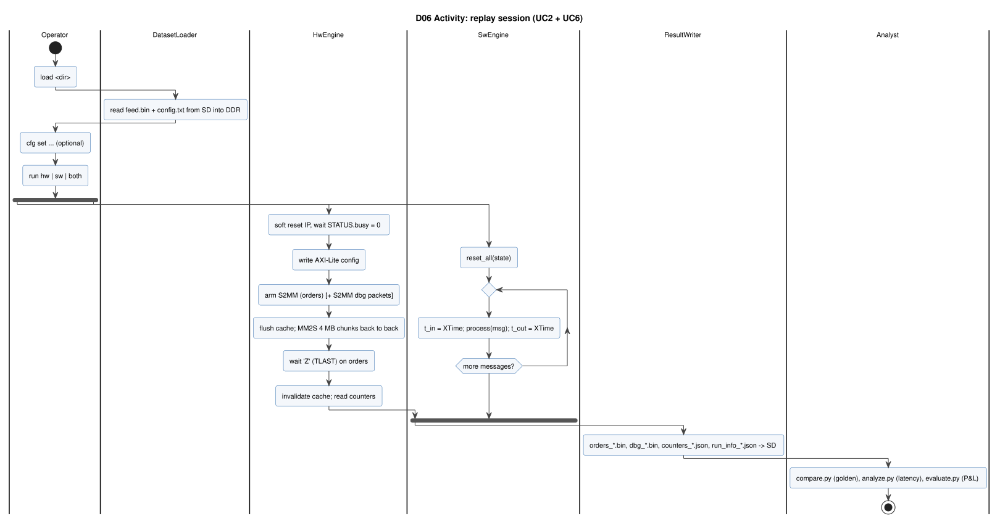
* **D07, product slot lifecycle.** PREOPEN → OPEN → (HALT) → CLOSED → PREOPEN on slot reuse.
  The anchor (ladder centre) can only change while the slot has no live orders, which is what
  makes the hardware's window-offset representation exact (DECISIONS H-1).
  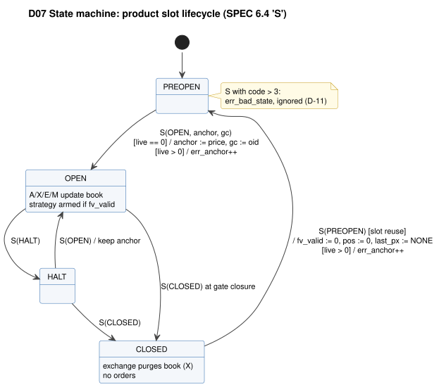
* **D08, per-product strategy:** NoFV / Armed / Fired-dedup / Locked-out.
  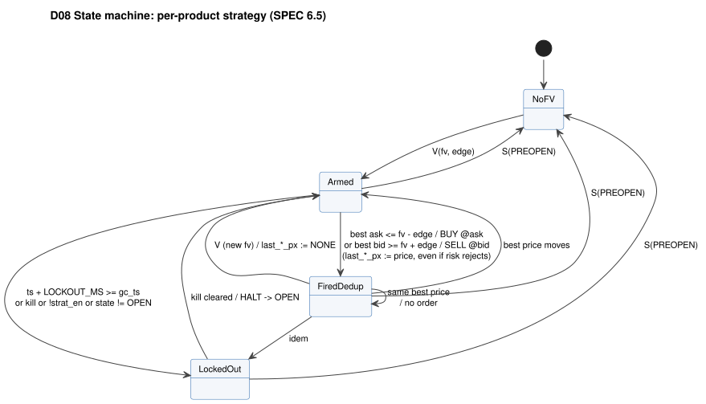
* **D09, SessionController** (implemented 1:1 in `sw/app/session.hpp`).
  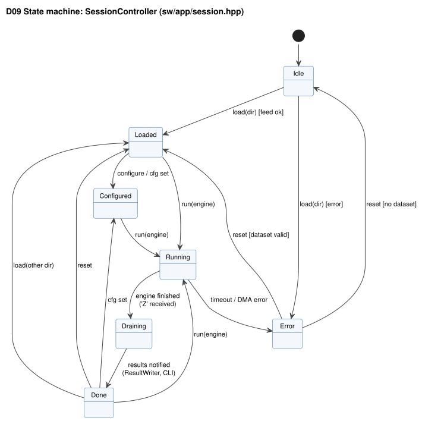
* **D15 / D16, sequences:** a triggering message beat by beat through the probes and the IP, and
  a CLI `run hw` session.
  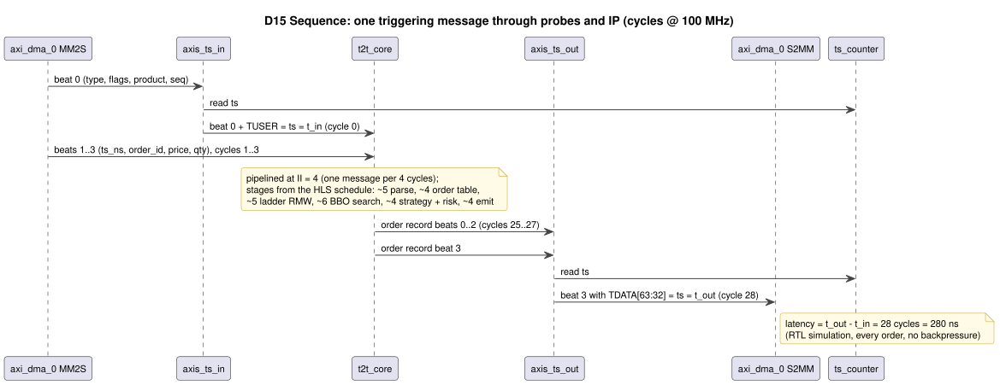 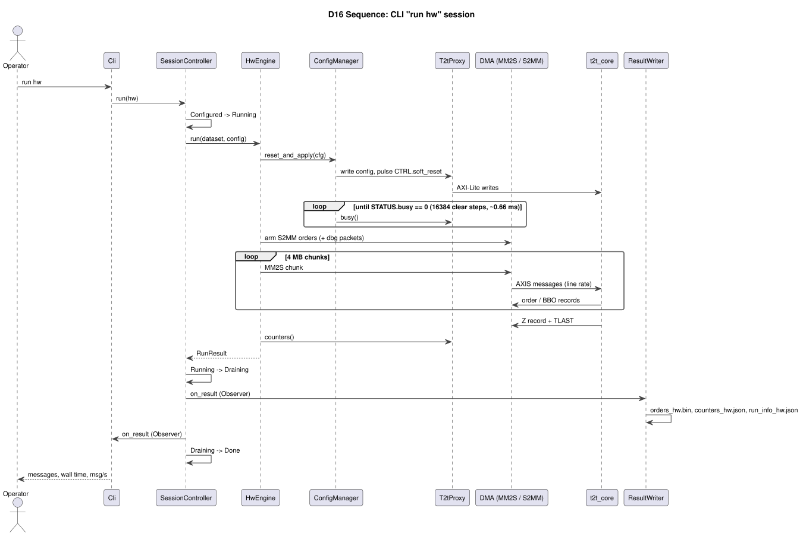

## Logical structure

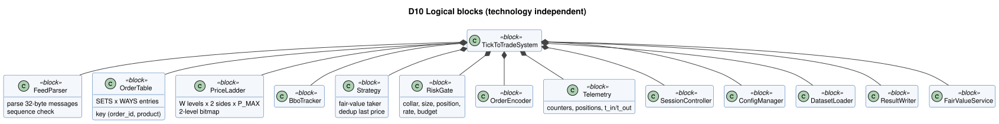
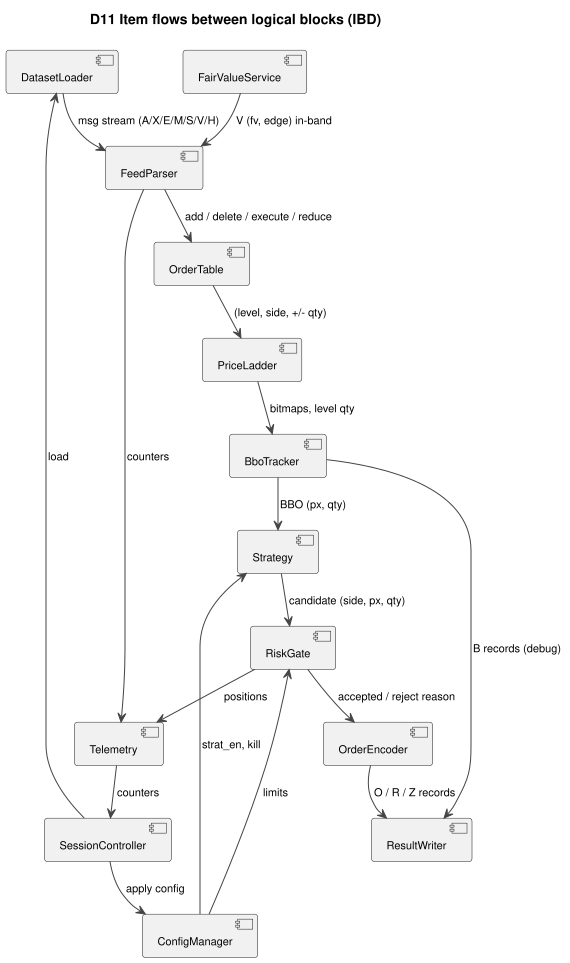

| Logical block | Responsibility | Implementation |
|---|---|---|
| FeedParser | decode 4 beats, sequence check, classify | `engine.hpp` (step 1–3) |
| OrderTable | 4-way set-associative, key (order_id, product) | `order_table.hpp` |
| PriceLadder | aggregated qty per level, 2-level bitmap | `price_ladder.hpp`, `engine.hpp` RMW |
| BboTracker | best bid / ask from bitmaps | `ladder_bbo` |
| Strategy | fair-value taker with price dedup | `strategy.hpp` |
| RiskGate | collar, size, position, rate, budget | `risk.hpp` |
| OrderEncoder | `'O'`/`'R'`/`'Z'` and `'B'` records | `dk1proto.hpp`, `engine.hpp` |
| Telemetry | counters, positions, timestamps | `Counters`, AXI-Lite, probes |
| SessionController, ConfigManager, DatasetLoader, ResultWriter | Part 2 (PS) | `sw/app` |
| FairValueService | slow path, in-band `V` | generator (`data/generator/sim.py`) |

## Latency budget (parametric)

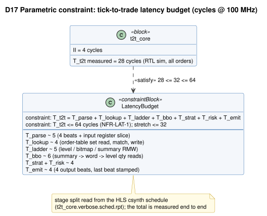

The budget constraint `T_t2t = Σ stages ≤ 64 cycles` is satisfied with **28 cycles measured** in
the RTL system simulation of the exported IP. That also meets the stretch target of ≤ 32.
