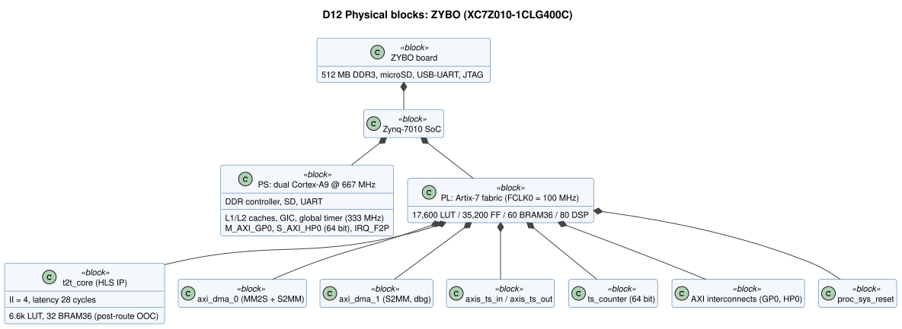
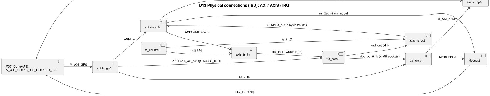
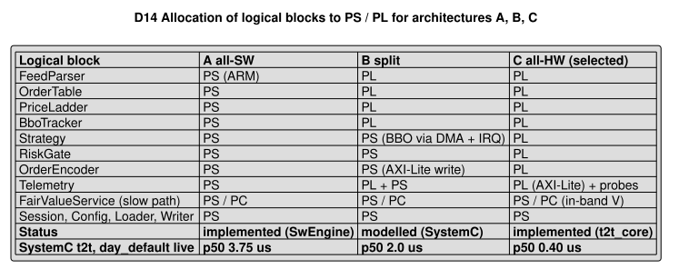
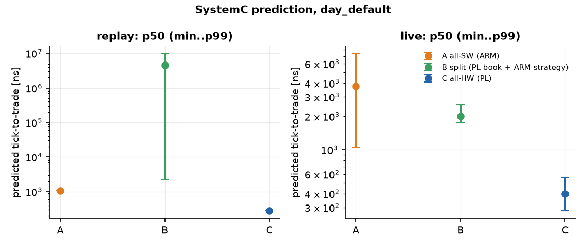

# 4. Architecture alternatives and allocation

Physical platform:  

Allocation of the logical blocks of D10 onto the Zynq-7010:

| Arch | Parser | Book / BBO | Strategy + risk | Order out | Status |
|---|---|---|---|---|---|
| **A** all-SW | ARM | ARM | ARM | ARM | implemented (`SwEngine`, same C++ core) |
| **B** split | PL | PL | ARM (BBO via DMA + IRQ) | ARM (AXI-Lite) | modelled in SystemC |
| **C** all-HW | PL | PL | PL | PL | **selected**, implemented (`t2t_core`) |

The slow path (fair value from forecasts) is software in all three. It enters the fast path
in-band as `V` messages, which keeps every run deterministic.

## SystemC exploration

`systemc/arch_model.cpp` is a loosely-timed, trace-driven SystemC 2.3.4 model. It uses the
processes `FeedSource`, `PlPipeline`, `Delay` (DMA S2MM + interrupt) and `ArmCpu`, bound with
`sc_fifo` channels. The dataset's real message stream is replayed, and the messages that must
produce an order are taken from the golden model, so all three architectures do the same work.
Two arrival modes are simulated:

* **replay:** messages back to back from DDR in 4 MB DMA chunks (the board measurement setup);
* **live:** each message arrives at its exchange timestamp, so bursts queue in the slower resources.

Parameters (`systemc/params.yaml`) are tagged *measured* or *assumed*. The PL numbers (II = 4,
latency 28 cycles, 100 MHz) are measured. The ARM costs and the DMA/IRQ latencies are
**assumed** until the board run replaces them.

Predicted tick-to-trade (`make sysc`, `systemc/out/summary.json`):

| dataset | mode | A all-SW | B split | C all-HW |
|---|---|---|---|---|
| cosim_10k | replay | 1 050 ns (all) | p50 144 µs (ARM saturated) | 280 ns (all) |
| cosim_10k | live | p50 2 850, p99 7 350 ns | p50 1 840, p99 2 510 ns | p50 360, p99 560 ns |
| day_default | replay | 1 050 ns | p50 4.6 ms (saturated) | 280 ns |
| day_default | live | p50 3 750, p99 7 350 ns | p50 2 010, p99 2 550 ns | p50 400, p99 560 ns |

**Why C.**
* **B** removes the parse/book cost from the ARM, but every BBO change still crosses DMA +
  interrupt + ARM (~1.8–2.5 µs). When the PL delivers BBO updates at line rate (replay), the
  ARM cannot keep up and the queue grows without bound.
* **A** is the simplest, but each message costs the ARM ~1 µs (assumed), and same-timestamp
  bursts (market-maker refreshes) queue up to ~7 µs.
* **C** has no shared resource slower than the line rate. Its latency is the pipeline depth
  (28 cycles) plus at most a few messages of same-timestamp queueing at 4 cycles each (live p99
  560 ns), and it fits the Z7-010 with margin (61 % LUT, 61 % BRAM for the whole system).

The latency-sensitivity evaluation (`ref/evaluate.py`, §08) shows why that matters: the fill rate
of the strategy's orders drops from ~95 % at ≤ 10 µs to ~39 % at 100 µs, because the simulated
competitor takers react after 50 µs–50 ms.

## Two-Part Architecture mapping (course terminology)

* **Part 1, hard real-time:** the PL fast path, i.e. `t2t_core`, the AXIS timestamp probes, the
  counter and the DMA streaming data path. Its deadline (one message per 4 cycles) is met by
  construction (static II = 4 schedule). No OS, no interrupts, no caches in the path.
* **Part 2, soft / non-real-time:** the PS application on the Cortex-A9. It handles dataset
  I/O from SD, configuration over AXI-Lite, DMA control, result capture and logging, the UART
  CLI, the Architecture-A software baseline, and (off-line) the fair-value slow path.
