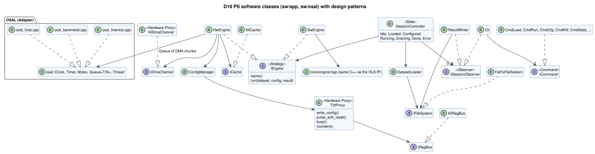

# 5. Software design and design patterns

The PS application (`sw/app`, C++11 for the Cortex-A9, bare metal, SDK 2017.2) is Part 2 of the
Two-Part Architecture. Every hardware access sits behind an interface. That lets the whole
session logic run on the PC in `sw/host_test/test_sw.cpp` against mocks and a *virtual board*,
where the mock DMA channels push data through the real HLS top function.

| Pattern (Douglass) | Where | Why |
|---|---|---|
| **Hardware Proxy** | `T2tProxy` (only class that knows register offsets, generated `t2t_regs.h`), `XilDmaChannel` | Isolates register/driver details. The host tests replace the bus with `VirtualT2t`, which maps register writes to the HLS function arguments. |
| **Adapter** | `osal::Clock/Timer/Mutex/Queue/Thread` with `osal_baremetal.cpp` (XTime, usleep) and `osal_host.cpp` (std::chrono) | Portability: a course OS package or FreeRTOS would be a third adapter. |
| **State** | `SessionController` (Idle → Loaded → Configured → Running → Draining → Done / Error, D09); product state machine in the core (D07) | Explicit, testable lifecycles that match the SysML state machines. `test_session_states` checks the transition sequence. |
| **Strategy** | `IEngine` with `HwEngine` (Arch C) and `SwEngine` (Arch A) | The same session code runs either architecture, so the comparison is fair. Within the core, the trading strategy is a separate function (`strategy_step`). |
| **Observer** | `ISessionObserver`: `ResultWriter` (files to SD), `Cli` (UART progress) | Reporting is decoupled from control flow. Adding a new sink needs no session change. |
| **Command** | `ICommand` objects (`CmdLoad`, `CmdRun`, `CmdCfg`, `CmdKill`, `CmdStats`, `CmdLs`, `CmdReset`, `CmdHelp`) in a fixed table | Extensible, individually testable command handling with no dynamic allocation. |
| **Queuing / ring buffer** | `osal::Queue<uint32_t,64>` of MM2S chunk offsets in `HwEngine` | Bounded memory. Chunks (< 8 MB each, the 23-bit DMA limit) are issued back to back. |

## Bare-metal specifics

* **BSP:** FatFs is built with long file names (`use_lfn`; off by default in xilffs), because
  dataset folders and result files are not 8.3 names. Stack and heap are 256 KB each.
* **Run self-checks (D-36):** the soft reset is verified by reading the counters back, the
  order stream must end with `'Z'`, DMA error bits are polled, and the IP's message count must
  equal the dataset size with `err_framing == 0`. A failed check ends the run with a message.
* **Dataset check (D-35):** `feed.bin` must end with exactly one `H(END_OF_SESSION)`.

* **Memory map** (`platform.hpp`), original ZYBO with 512 MB DDR: input buffer 192 MB at
  0x0200_0000 (≤ 6 M messages), HW order buffer < 8 MB, HW debug buffer 48 MB (1.5 M BBO
  records), SW output buffers. Code, heap and stack stay below 32 MB.
* **DMA:** polled, simple mode, with caches flushed before MM2S and invalidated after S2MM.
  `dbg_out` arrives in 4 MB TLAST-terminated packets, so S2MM is re-armed per packet (D-30).
* **Soft reset:** the IP clears its memories in 16 384 steps (~0.66 ms). `STATUS.busy` rises
  about 30 cycles after the reset edge (it is written at the end of the IP pipeline, observed
  in RTL simulation), so `ConfigManager` waits 5 µs before polling.
* **SwEngine timestamps:** `t_in`/`t_out` are the low 32 bits of the global timer (CPU/2: 325 MHz on
  the ZYBO preset, CPU 650 MHz, measured on the board), taken before `process()` and when the
  record is complete. The frequency is written to `run_info_*.json` (`timer_hz`) and used by the analysis.

## Host unit tests (`make sw-host-test`)

`sw/host_test/test_sw.cpp`, g++ on the PC: 99 checks over `hand_case`, `unit_tiny`,
`cosim_10k`, `edge_errors` and `edge_table_full`. A separate run on `stress_burst` covers
1.37 M messages and 9 DMA chunks.

* config `key=value` parsing, dataset loader error handling;
* session state transitions and observer notifications;
* CLI parsing (`cfg set`, `kill on/off`, unknown commands);
* `T2tProxy` register offsets;
* failure handling: a DMA status error, an IP that does not clear on soft reset, result files
  that cannot be written, datasets without (or with an early) END_OF_SESSION, non-numeric
  `cfg set` values, and `run both` continuing with the software engine after a hardware failure;
* framing recovery of the IP top (messages cut short by TLAST are dropped and counted);
* **SwEngine output = golden** (orders, BBO trace) on every dataset;
* **HwEngine on the virtual board = golden**, using the real `t2t_core` HLS function behind
  mock DMA channels. This covers soft-reset polling, multi-chunk MM2S and packetised debug S2MM
  (packet size reduced to 64 records to exercise re-arming).
