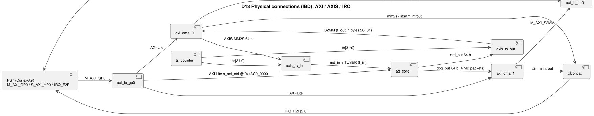

# 7. Implementation on the ZYBO

Board: **original Digilent ZYBO** (XC7Z010-1CLG400C, 512 MB DDR3), with Vivado / Vivado HLS /
SDK **2017.2**. See [hw/README](../hw/README.md) and [sw/README](../sw/README.md) for the
build steps.

## Block design (`hw/build_bd.tcl`)



* PS7 with the ZYBO board preset, FCLK0 = 100 MHz, GP0 master, HP0 64-bit slave, IRQ_F2P.
* `axi_dma_0`: MM2S → `axis_ts_in` → `t2t_core.md_in`; `t2t_core.ord_out` → `axis_ts_out` → S2MM.
* `axi_dma_1`: S2MM ← `t2t_core.dbg_out` (BBO trace, 4 MB packets).
* `ts_counter` (64-bit) → `[31:0]` → both probes. Probes are module references (plain Verilog).
* AXI-Lite map: `axi_dma_0` 0x4040_0000, `axi_dma_1` 0x4041_0000, `t2t_core` 0x43C0_0000.
* The HP0 interconnect is wired explicitly: the 2017.2 `axi4` automation rule fails for the DMA
  masters.
* AXI DMA v7.1 (2017.2) allows at most a 23-bit length register (8 MB − 1). The PS therefore
  streams the input in 4 MB chunks, and the IP terminates debug packets every 131 072 records (D-29/D-30).

## Implementation results (`hw/reports/`, `make vivado`)

| Metric | Value |
|---|---|
| Timing @ 100 MHz | **met**: WNS **+0.969 ns**, WHS +0.017 ns (post-route, whole system) |
| Slice LUTs | 10 472 / 17 600 (**59.5 %**) |
| Slice registers | 15 123 / 35 200 (43.0 %) |
| Block RAM tiles | 36.5 / 60 (**60.8 %**) |
| DSPs | 3 / 80 |
| Build time | about 7 min (synthesis + implementation + bitstream, 6 jobs) |

Outputs: `hw/dk1_t2t.bit`, `hw/dk1_t2t.hdf` (SDK 2017.2 hardware handoff; Vitis would use .xsa),
`hw/address_map.txt`, `hw/system_bd_export.tcl`.

The build fails (and publishes no bitstream) if timing is not met. A sub-run that hangs at
Vivado start-up is killed by the build driver and launched again (D-40).

## PS application (`sw/`, `make sw`)

Built with xsct / SDK 2017.2 against the HDF: standalone BSP + `xilffs`, C++ application
`t2t_app.elf` (text 272 KB, bss 673 KB; FatFs with long file names, 256 KB stack and heap). UART CLI at 115 200 baud:

```
t2t> ls
t2t> load day_default
t2t> cfg set dbg_en 0
t2t> run both
t2t> stats
```

## On-board measurement procedure (SPEC 10.5)

Done on 2026-11-20 with the original ZYBO powered from USB (JP7 = USB, JP5 = JTAG). Results in
§08 and `runs/board/`.

1. Format the microSD as **FAT32** (the 2017.2 FatFs has no exFAT; `format E: /FS:FAT32 /Q` also
   works above 32 GB on current Windows 11). Copy `data/out/<name>/{feed.bin,config.txt}` into one
   folder per dataset (`cosim_10k`, `edge_errors`, `stress_burst`, `day_default`).
2. Insert the card, power the board, connect PROG/UART. Windows shows two FTDI ports (here
   COM4 = channel A, which also carries JTAG; COM5 = the UART).
3. Program and drive the console from the PC; everything is logged to `runs/board/uart_*.log`:
   ```
   python tools/board_session.py --program -- ls "load cosim_10k" "cfg set dbg_en 1" "run both"
   python tools/board_session.py -- "load day_default" "cfg set dbg_en 0" "run both" stats
   ```
   `--program` runs `xsct sw/run_board.tcl` with no serial port open (holding COM4 hides the board
   from `hw_server`). A terminal at 115 200 8N1 on the UART port works as well.
4. Debug-trace runs need ≤ 1.5 M messages (48 MB debug buffer), so `day_default` runs with
   `dbg_en 0`.
5. Copy `<ds>/*_hw.*` and `*_sw.*` from the card into `runs/board/<ds>/` and run
   `make analyze RUN=runs/board/<ds> SCEN=<ds>` (bit-exact comparison + latency/throughput into
   `latency_summary.json` and `docs/img/latency_hist_<ds>.png`).
6. Put the measured ARM cost into `systemc/params.yaml` and run `make sysc`.

Observed on the board: the global timer runs at 325 MHz (CPU 650 MHz in the ZYBO preset); FatFs
stamps files 2010-01-01 because the board has no real-time clock. The first `ls` hung the board
(D-41, fixed before the measurement runs).
