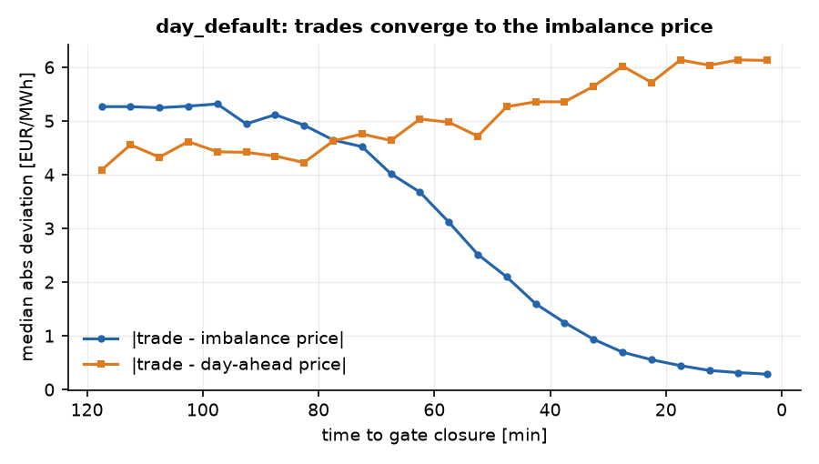
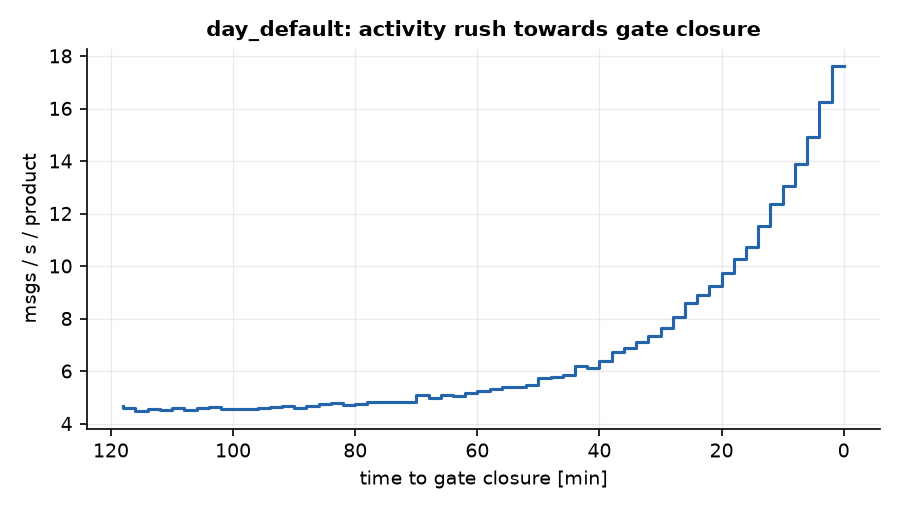
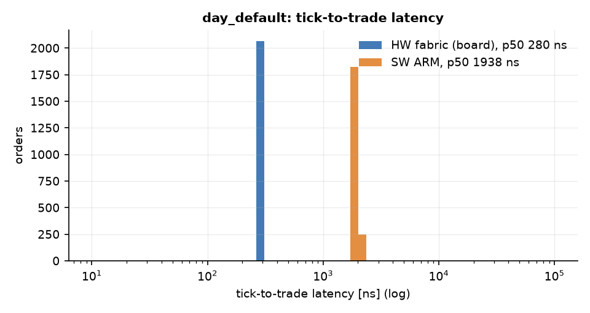
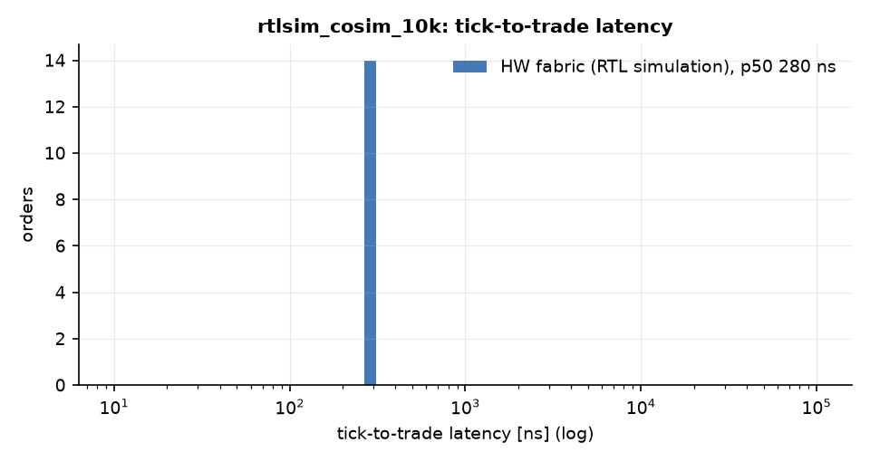
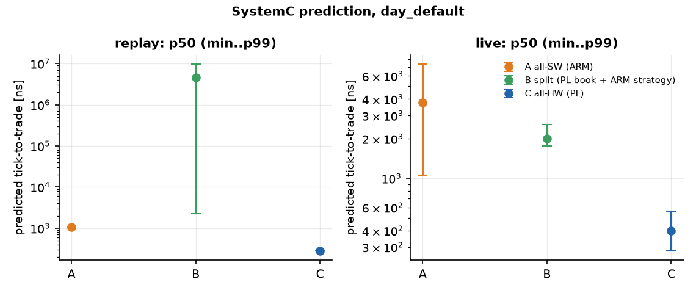
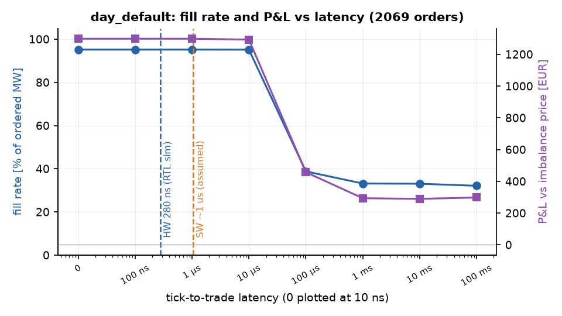

# 8. Results

Every number on this page comes from a run in this repository, and the command that produced
it is given next to it. **On-board results** come from the original ZYBO on 2026-11-20
(bitstream and ELF of commit `c0b158c` plus the `ls` fix D-41), driven over JTAG + UART by
`tools/board_session.py`; the UART logs, result files and analyses are in `runs/board/`. Latency on
the board is measured by the `axis_ts_in` / `axis_ts_out` probes in PL cycles (100 MHz), and for the
ARM baseline by the Cortex-A9 global timer (325 MHz). Simulation rows are kept next to them.

Toolchain: Vivado / Vivado HLS / SDK 2017.2, xc7z010clg400-1 (original ZYBO), 100 MHz PL clock.
Generator version 1.0.0, scenario seeds in `data/scenarios/*.yaml`.

## R1. Correctness (bit-exact vs. golden, timestamps masked)

| Check | Scope | Result | Command |
|---|---|---|---|
| Python ↔ C++ random cross-check | 12 000 sequences, 2.53 M messages, 2 geometries; all 14 error counters, 4 reject reasons, both sides hit | identical | `pytest tests/test_xcheck.py` |
| Hand-derived expectations | 24 messages → 10 order, 22 BBO records, counters | model and C++ identical to hand values | `tests/hand_case.py`, `build/tb_t2t tests/hand_case build` |
| C++ unit tests | table, ladder, residues, encoders, strategy, risk, protocol, reset | 1 082 / 1 082 | `make test-cpp` |
| csim (g++ + shim) | all 10 datasets below (orders + BBO trace + counters) | all PASS | `make csim-all` |
| Vivado HLS csim | `cosim_10k` | PASS | `make hls` |
| C/RTL co-simulation (xsim) | `cosim_10k`: 12 004 msgs → 25 ord + 11 603 BBO records, after a 16 384-step soft reset | **PASS** (`*** C/RTL co-simulation finished: PASS ***`) | `make cosim`, `hls/reports/cosim1/` |
| **Nasdaq ITCH 5.0 converter** vs MeatPy (open-source parser) and `itch_counts.py` | 30 Dec 2019 sample, first 100 k msgs (SPEC) and first 20 M msgs | per-type counts identical for all 3 decoders (17 types); 493 865 converted records identical in every field | `python data/itch_xcheck.py <file> --symbols ... --max-messages 20000000`, `runs/itch/` |
| **`itch_sample` on the board** (real Nasdaq order flow, 1 479 311 msgs, debug trace on) | HW engine and ARM SwEngine | **bit-exact**: 1,479,311 BBO records + counters equal to golden on both engines; FPGA 14.4 M msg/s, ARM 0.46 M msg/s | `tools/board_session.py`, `make analyze RUN=runs/board/itch_sample SCEN=itch_sample` |
| **Live replay on the board** (FreeRTOS, paced at ×1000 and ×10000 of real market time, docs/09) | `itch_sample`, HW and SW engine, 4 runs | **bit-exact**: 1 479 311 BBO records + counters each; 0 deadline misses in 165 000 jobs | `tools/board_session.py --elf sw/bin/t2t_rtos.elf`, `runs/rt/` |
| RTL system simulation, line rate | `cosim_10k` (12 004 msgs), `edge_errors` (12 048), `stress_gc_rush` (968 538) | 0 mismatching records | `make rtl-system` |
| RTL system simulation, framing recovery (D-34) | 3 fragments cut by TLAST on beat 0/1/2, then the full `cosim_10k` / `edge_errors` stream | `err_framing` = 3, `msgs_in` exact, 0 mismatching records, latency still 28 | idem |
| RTL system simulation, random backpressure | `cosim_10k`, `edge_errors` | 0 mismatching records | idem |
| PS software on host (SW engine + virtual-board HW engine, failure injection) | hand case, unit_tiny, cosim_10k, edge_errors, edge_table_full, stress_burst; DMA error, dead IP, unwritable SD, bad datasets, CLI errors | 99 + 59 checks pass | `make sw-host-test` |
| **On board (ZYBO)**: HW engine and ARM SwEngine | `cosim_10k`, `edge_errors`, `stress_burst` with the debug trace (1.37 M msgs, 1.37 M BBO records); `day_default` orders + counters (4.69 M msgs) | **bit-exact on both engines**: orders, BBO trace and counters equal to golden on all 4 datasets; `err_framing` 0 | `tools/board_session.py`, then `make analyze RUN=runs/board/<ds> SCEN=<ds>`; `runs/board/<ds>/latency_summary.json` |

## R2. Datasets and capacity / robustness scenarios

`make data-all ref-all` (golden counters from `ref/run_ref.py`):

| Scenario | Messages | Products | Fundamentals | 'O' | 'R' | Error counters (golden = csim = RTL) |
|---|---|---|---|---|---|---|
| `unit_tiny` | 1,335 | 2 | synthetic:default | 3 | 0 | none |
| `cosim_10k` | 12,004 | 3 | synthetic:default | 14 | 10 | none |
| `day_default` | 4,692,944 | 96 | synthetic:default | 2069 | 294 | none |
| `day_eds` | 4,707,049 | 96 | **real Energi Data Service DK1, 2026-01-15** | 2096 | 301 | none |
| `stress_burst` | 1,371,029 | 12 | synthetic:default | 182 | 63 | none |
| `stress_gc_rush` | 968,538 | 20 | synthetic:default | 337 | 68 | none |
| `edge_negative_prices` | 61,810 | 5 | synthetic:negative (+ anchors at ±9 990 EUR) | 55 | 17 | none |
| `edge_oow` | 62,601 | 5 | synthetic:default | 41 | 2 | oow 1280 |
| `edge_table_full` | 36,644 | 4 | synthetic:default | 29 | 2 | table_full 2913, not_found 3090 (> 4096 live orders + crafted set collisions) |
| `edge_errors` | 12,048 | 3 | synthetic:default | 4 | 0 | unknown_type 60, bad_product 60, not_found 60, dup_id 60, grid 40, seq_gap 40, qty_over 60 |
| `itch_sample` | 1,479,311 | 8 | **real Nasdaq TotalView-ITCH 5.0, 2019-12-30** (VUG NVS PUK DEO SMLL OILU SCO SAP, full day) | 0 | 0 | oow 14106, table_full 9928, not_found 11020, grid 1: capacity / format limits only (D-42); all anomaly counters 0 |

Generator realism (`python data/validate_stylized.py data/out/day_default`, plots `docs/img/data_day_default_*`):

| Stylised fact | day_default | day_eds |
|---|---|---|
| spread p50 / p90 | 0.30 / 1.00 EUR | 0.30 / 1.00 EUR |
| crossed book after matching | 0 % | 0 % |
| message rate, last 5 min vs window mean | 2.45× | 2.45× |
| depth at best (median) | 3.8 MW | 3.8 MW |
| \|trade − imbalance price\| first 10 % → last 10 % of window | 5.38 → 0.31 EUR | 29.5 → 0.55 EUR |
| order lifetime (median) | 3.3 s | 3.3 s |
| OOW / grid errors | 0 % / 0 % (< 0.5 % required) | 0 % / 0 % |

 

## R3. Fast-path latency and throughput

| Source | Orders | Latency t_out − t_in | Jitter | Input rate | Command |
|---|---|---|---|---|---|
| HLS csynth schedule | — | 28 cycles (pipeline) | — | II = 4 | `make hls` |
| **RTL system sim**, `cosim_10k`, no backpressure | 14 | **28 cycles = 280 ns** (min = p50 = p99 = max) | **0** | 4.0 cycles/msg = **25 M msg/s** | `make rtl-system`, `tools/analyze.py build/rtlsim/cosim_10k` |
| **RTL system sim**, `stress_gc_rush` (968 538 msgs), no backpressure | 337 | **28 cycles = 280 ns** for every order (min = p99 = max); 68 rejects also 28 | **0** | 4.0 cycles/msg over 3.87 M cycles | `DK1_SYS_DS=stress_gc_rush DK1_SYS_TESTS=line_rate pytest rtl/tests/test_system.py` (21 min) |
| **Board probes (HW)**, all 4 datasets | 2 269 | **28 cycles = 280 ns** for every order (min = p50 = p99 = max) | **0** | `day_default`: 4.0017 cycles/msg = **24.99 M msg/s** in the fabric, **24.98 M msg/s wall clock incl. DMA** (4.69 M msgs in 187.9 ms) | `tools/board_session.py`, then `make analyze RUN=runs/board/<ds> SCEN=<ds>`; `runs/board/<ds>/latency_summary.json` |
| Board HW, debug trace on | | 280 ns | 0 | `stress_burst` 6.8 cycles/msg = 14.7 M msg/s (the BBO trace adds a second 32-byte output per message) | idem |
| **Board SwEngine (Arch A, Cortex-A9 @ 650 MHz)**, `day_default` | 2 069 | **p50 1.94 µs, p99 2.13 µs, max 2.94 µs** | 1.0 µs | 0.53 M msg/s (8.84 s) | idem |
| Board SwEngine, debug trace on | 182 (`stress_burst`) | p50 2.04 µs, p99 2.39 µs | | 0.46 M msg/s | idem |

**Speed-up of the fabric over the ARM on the board** (`day_default`): **6.9× at p50, 7.6× at p99** in
tick-to-trade latency, with no jitter instead of 1 µs, and **47× in throughput** (24.98 M vs 0.53 M
msg/s). The software latency is measured from the start of `process()` to the completed order
record, so it excludes any input DMA; the hardware latency is measured at the IP's stream
ports. Both are therefore core processing latency, compared like for like.

## R4. Resources and timing

| Level | LUT | FF | BRAM36 | DSP | Timing @ 10 ns | Source |
|---|---|---|---|---|---|---|
| HLS estimate (`t2t_core`) | 16 467 | 19 199 | 32 (64 BRAM18) | 5 | 11.05 ns (HLS model) | `hls/reports/impl1/t2t_core_csynth.rpt` |
| Post-route, OOC, `t2t_core` only | 6 333 (36.0 %) | 9 544 (27.1 %) | 32 (53.3 %) | 3 | **WNS +1.665 ns** | `hls/reports/impl1/ooc_*.rpt` |
| **Post-route, whole system** (PS7, 2 DMAs, interconnects, probes, IP) | **10 472 (59.5 %)** | 15 123 (43.0 %) | **36.5 (60.8 %)** | 3 | **WNS +0.969 ns, WHS +0.017 ns** | `hw/reports/utilization.rpt`, `timing_summary.rpt` |

`python tools/parse_hls_reports.py` collects these into `hls/reports/summary.json`.

## R5. Kill switch (NFR-SAF-1)

RTL system simulation, `rtl/tests/test_system.py::kill_switch`. `CTRL.kill` is written over
AXI-Lite in the middle of the stream, right after the message that triggers the middle golden
order. The test records the cycle in which the write response completes:

| Dataset | Orders before kill | Orders whose first beat arrived ≥ 10 cycles after the write | Result |
|---|---|---|---|
| `cosim_10k` | 8 | 0 | PASS |
| `edge_errors` | 3 | 0 | PASS |

## R6. Architecture exploration: SystemC predictions vs. measurements

`make sysc` → `systemc/out/summary.json` (parameters in `systemc/params.yaml`, measured or assumed):

| | A all-SW | B split | C all-HW |
|---|---|---|---|
| replay (board setup), day_default | 1.94 µs, run 8.837 s *(ARM cost calibrated on this run)* | ARM saturates (p50 4.6 ms) | 280 ns, run 0.1878 s |
| live (exchange timestamps), day_default | p50 7.59 µs, p99 15.1 µs | p50 2.01 µs, p99 2.55 µs | p50 400 ns, p99 560 ns |
| **measured on the board**, day_default replay | p50 1.94 µs, run 8.838 s | not built (model only) | **280 ns, run 0.18786 s** |

**C (validated on the board, not calibrated):** the model predicted 280 ns and a 0.1878 s run for
`day_default` including the 36 DMA chunk re-arms; the board measured 280 ns and 0.18786 s, an
error below 0.1 %. Its PL latency parameter came from RTL simulation, so the latency agreement
confirms that the bitstream behaves like the simulated RTL; the run time also checks the DMA
model (chunk size and an assumed 2 µs re-arm gap).

**A (calibrated on the board, then cross-checked):** `arm_msg_ns` = 1 883 ns (wall time per
message) and `arm_order_extra_ns` = 55 ns were set from the `day_default` SwEngine run, so the
`day_default` A row matches by construction. On the other datasets, run with the debug trace on,
the calibrated model is optimistic: `cosim_10k` 22.6 ms predicted vs 25.75 ms measured (−12 %),
p50 1.94 µs vs 2.10 µs (−8 %); `stress_burst` 1 883 vs 2 158 ns per message (−13 %). The gap is
the cost of producing the BBO trace on the ARM, which the model does not include. With the real
ARM cost, A in live mode queues behind same-timestamp bursts (p99 15 µs), so the conclusion
of §04 (C over A and B) is strengthened. B remains a model only: its ARM and DMA/IRQ costs are
assumed.

## R7. Latency sensitivity: fill rate and P&L vs. latency (headline chart)

`python ref/evaluate.py data/out/day_default` (simulated exchange, IOC, no market impact, P&L
vs. the delivery period's imbalance price):

| Latency | 0 | 100 ns | 1 µs | 10 µs | 100 µs | 1 ms | 10 ms | 100 ms |
|---|---|---|---|---|---|---|---|---|
| fill rate (day_default) | 95.2 % | 95.2 % | 95.2 % | 95.2 % | 38.8 % | 33.2 % | 33.1 % | 32.1 % |
| P&L EUR (day_default) | 1 298 | 1 298 | 1 298 | 1 293 | 458 | 294 | 290 | 298 |
| fill rate (day_eds, real fundamentals) | 93.7 % | 93.7 % | 93.7 % | 93.6 % | 36.9 % | 31.4 % | 31.3 % | 30.8 % |
| P&L EUR (day_eds) | 10 274 | 10 274 | 10 274 | 10 255 | 591 | −1 181 | −1 196 | −1 011 |

The simulated competitors react after 50 µs–50 ms, so the opportunities are gone between 10 µs
and 100 µs. The fabric latency (280 ns) sits on the flat, profitable plateau, and the software
baseline (~1 µs, assumed) does too. The difference that matters is to network-attached or
millisecond-class systems. Synthetic data, simplified exchange: this illustrates latency
sensitivity, not real profitability.

## Requirement verdicts

| Req | Verdict | Evidence |
|---|---|---|
| FR-01 parse / skip unknown | **PASS** | R1 (xcheck), R2 `edge_errors` |
| FR-02 order table + ladder | **PASS** | R1, `test_core` |
| FR-03 BBO after every product message | **PASS** | bit-exact `'B'` trace in R1 (csim, cosim, RTL, host) |
| FR-04 strategy | **PASS** | hand case, `test_core.test_strategy`, R1 |
| FR-05 pre-trade risk | **PASS** | `test_core.test_risk` (all reasons), xcheck coverage |
| FR-06 kill switch | **PASS** | `test_core`, R5 |
| FR-07 AXI-Lite config + counters | **PASS (board)** | config written from `config.txt`, counters read back equal to golden (`counters_hw.json`) |
| FR-08 order format + timestamps | **PASS** | R1, R3 |
| FR-09 debug BBO trace | **PASS** | R1 |
| FR-10 identical core on the ARM | **PASS (board)**: SwEngine bit-exact on all 4 datasets | R1, `runs/board/` |
| FR-11 product lifecycle / slot reuse | **PASS** | 96 products on 8 slots in `day_default`, generator invariants |
| NFR-LAT-1 p99 ≤ 64 cycles (stretch ≤ 32) | **PASS (board): 28 cycles = 280 ns**, stretch met | R3 |
| NFR-LAT-2 jitter ≤ 8 cycles | **PASS (board): 0 cycles** over 2 269 orders | R3 |
| NFR-THR-1 1 msg / 4 cycles | **PASS (board): 4.0017 cycles/msg, 24.98 M msg/s wall clock** | R3 |
| NFR-THR-2 no loss on `stress_burst` | **PASS (board)**: 1 371 029 msgs in, every order and BBO record bit-exact | R1 |
| NFR-CAP-1 capacity | **PASS** | R2 edge scenarios, `test_core` |
| NFR-COR-1 bit-exact | **PASS** | R1 |
| NFR-RES-1 ≤ 70 % LUT/BRAM, timing met | **PASS**: 59.5 % LUT, 60.8 % BRAM, WNS +0.969 ns | R4 |
| NFR-ROB-1 robustness | **PASS** | `edge_errors` csim + RTL sim (incl. backpressure), xcheck; truncated transfers recovered (RTL `framing_recovery`) |
| NFR-SAF-1 kill latency | **PASS (RTL sim)** | R5 |
| Real-time schedulability of the PS tasks (course: RMA) | **PASS (board)**: RTA with measured WCET and release jitter, every measured response below its bound, 0 misses | docs/09 |
| NFR-DET-1 determinism | **PASS** | `test_generator.py::test_deterministic`; integer-only core |
