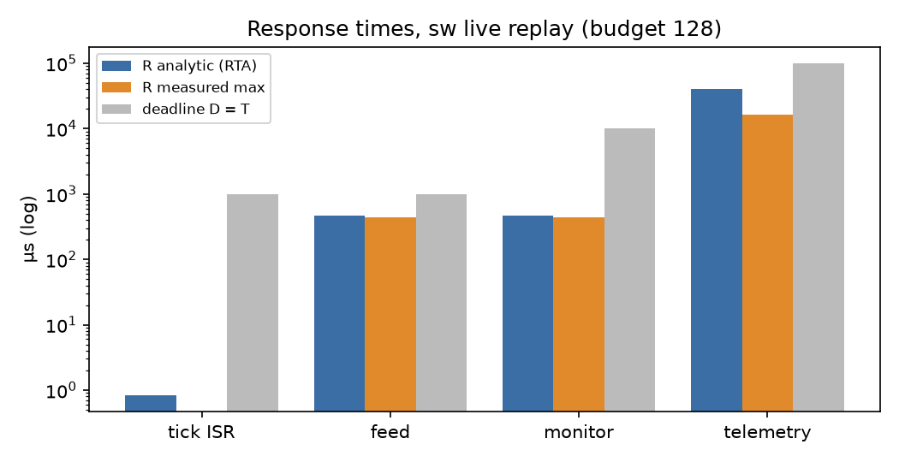
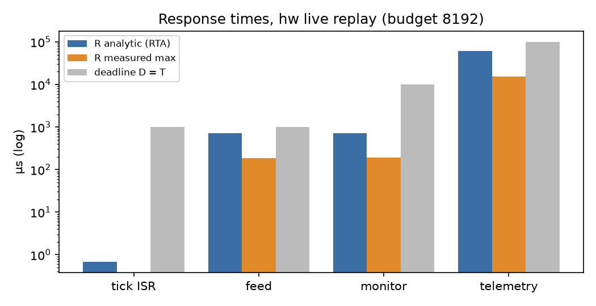

# 9. Real-time scheduling analysis of the live replay

The batch runs of §08 replay a whole day as fast as the DMA allows. *Live replay* instead
releases every market message at the time printed in the feed (sped up by a factor, e.g. ×1000),
the way a real feed would arrive. On the Cortex-A9 this is a small set of periodic tasks on
**FreeRTOS 9** (`sw/app/main_rtos.cpp`, `sw/app/live.hpp`, ELF `sw/bin/t2t_rtos.elf`). This
chapter analyses that task set with **Rate Monotonic Analysis (RMA)** and exact
**response-time analysis (RTA)**, using execution times measured on the board, and then checks
the analysis against measured response times on real Nasdaq data (`itch_sample`).

## 9.1 Task set

| Task | Priority | Period T = deadline D | Job |
|---|---|---|---|
| tick ISR | above all tasks | 1 ms | FreeRTOS tick (SCU private timer) |
| **feed** | 4 (highest task) | 1 ms | release the messages that are due, **at most `budget`** per job. HW: one MM2S DMA transfer (never waits for the DMA). SW: run them through the core on the ARM |
| **monitor** | 3 | 10 ms | collect the FPGA output (S2MM), detect the end, **stale-data guard**: if released data is older than `guard_ms`, set `CTRL.kill` (no orders on stale prices); clear it at `guard_ms`/2 |
| **telemetry** | 2 | 100 ms | one `@T {json}` status line on the UART (115 200 baud) |
| cli | 1 | background | command line; silent during a live run |

Priorities are **rate monotonic**: the shorter the period, the higher the priority. RMA is
optimal among fixed-priority assignments for implicit deadlines (D = T).

Design rules that make the analysis valid (each one is checked in the code):

1. **Bounded jobs.** The feed job releases at most `budget` messages (128 in SW mode, 8192 in HW
   mode), so its execution time has an upper bound regardless of how bursty the market is.
   Overload therefore shows up as *data lateness*, never as a task overrun.
2. **No blocking in jobs.** The feed job does not wait for the DMA: if the previous transfer is
   still running it returns and tries again next period. DMA completion is polled; the only
   interrupt is the tick.
3. **No expensive arithmetic in jobs.** The release time of every message is computed once,
   before the run, into a schedule table (`SCHED_BUF`). (A 64-bit division is a library call on
   the 32-bit Cortex-A9; doing it per message made one 8192-message job take 3.5 ms, see 9.6.)
4. **Shared resource.** The UART is protected by a FreeRTOS mutex with **priority inheritance**.
   Only telemetry and the CLI use it, and the CLI prints nothing while a live run is active, so
   the blocking term is **B = 0** for every analysed task.
5. **Critical instant.** All periodic tasks are released together at one tick T0 (synchronous
   release), the worst case assumed by RMA. Release times are exact: the FreeRTOS tick (SCU
   private timer) and the global timer both count at CPU/2 = 325 MHz, so job *k* of a task is
   released at T0 + k·T in global-timer ticks, and its response time is `end − release`.

## 9.2 Measuring execution times (`wcet hw|sw`)

`wcet` runs on the board with the CLI task raised above all application tasks (isolation):

* **tick ISR:** a busy loop records its longest interruption over 2 s (2000 ticks).
* **scheduling overhead:** the same with an empty 1 kHz task added; the difference is the cost
  of two context switches plus `vTaskDelayUntil`, added to every task's C.
* **feed / monitor:** the whole `itch_sample` day (1 479 311 messages) is replayed with speed 0,
  so *every* feed job releases a full budget (worst case); the maximum over all jobs is C.
* **telemetry:** 30 lines formatted with maximal-width numbers (the line length is what costs
  time at 115 200 baud: 87 µs per character).

Measured on the ZYBO (`runs/rt/wcet_sw.log`, `runs/rt/wcet_hw.log`):

| | tick ISR | overhead / job | feed C (budget) | monitor C | telemetry C |
|---|---|---|---|---|---|
| SW mode | 0.83 µs | 1.2 µs | **313.1 µs** (128 msgs, 2.45 µs/msg) | 0.8 µs | 27.1 ms |
| HW mode | 0.68 µs | 1.5 µs | **558.2 µs** (8192 msgs, 0.068 µs/msg) | 10.0 µs | 27.0 ms |

**Release jitter J.** Under load, a job sometimes starts later after its tick than the isolated
overhead probe suggests (cache misses after a lower-priority task ran, the scheduler, interrupts
masked inside library code). The live runs measure it: the largest R − C of the feed task was
134 µs, while the smallest response of any job was 1–2 µs (so this is not a constant offset in
the release times). The analysis uses **J = 150 µs** for every task (0 for the tick ISR).

These are measured maxima, not proven bounds (caches and DDR contention make a true WCET hard
to prove on the A9). The inputs were chosen to be worst case for each job, and 9.4 checks the
result against measured response times in normal operation.

## 9.3 Analysis (`tools/rma.py`)

Utilisation U = Σ Cᵢ/Tᵢ, with C = measured WCET + overhead:

| | U | Liu & Layland bound n(2^{1/n} − 1), n = 4 | Hyperbolic bound Π(Uᵢ + 1) ≤ 2 | Exact RTA |
|---|---|---|---|---|
| SW mode | 0.586 | 0.757: **passes** | 1.672: passes | all deadlines met |
| HW mode | 0.832 | 0.757: **not met** | 1.984: passes | all deadlines met |

The HW case shows why the Liu & Layland test is only *sufficient*: it fails, but the exact
analysis (and the board, 9.4) shows that the task set is schedulable.

Exact response times with release jitter (Audsley / Tindell):
wᵢ = Cᵢ + Bᵢ + Σ_{j ∈ hp(i)} ⌈(wᵢ + Jⱼ) / Tⱼ⌉ · Cⱼ (iterated to a fixed point), **Rᵢ = Jᵢ + wᵢ**:

| Task | T = D | SW mode: C → **R** | HW mode: C → **R** |
|---|---|---|---|
| tick ISR | 1 ms | 0.8 µs → 0.8 µs | 0.7 µs → 0.7 µs |
| feed | 1 ms | 314.4 µs → **465 µs** | 559.7 µs → **710 µs** |
| monitor | 10 ms | 2.0 µs → **467 µs** | 11.4 µs → **722 µs** |
| telemetry | 100 ms | 27.08 ms → **39.8 ms** | 27.0 ms → **62.0 ms** |

Worked example (SW mode, monitor, C = 2.0 µs, J = 150 µs): w⁰ = 2.0 µs. Higher priority: tick
(C 0.8 µs, J 0) and feed (C 314.4 µs, J 150 µs), both T = 1 ms. w¹ = 2.0 + ⌈2.0/1000⌉·0.8 +
⌈(2.0 + 150)/1000⌉·314.4 = 317.2 µs; the ceilings stay 1, so w = 317.2 µs and
**R = J + w = 467 µs ≤ D = 10 ms**.

**Budget headroom:** with the measured per-message feed cost, the RTA still accepts up to
**296** messages per job in SW mode and **10 642** in HW mode, i.e. the feeder can sustain about
0.30 M and 10.6 M released messages per second.

## 9.4 Validation on the board (real Nasdaq data)

`live <mode> <speed> [budget] [guard_ms]` on `itch_sample` (1 479 311 messages, 30 Dec 2019,
8 symbols), log `runs/rt/uart_rt.log`. "R max" is the longest measured response of any job:

| Run | Jobs (feed / monitor / telemetry) | Misses | R max feed / monitor / telemetry | Wall time | Lateness of data: max | Guard |
|---|---|---|---|---|---|---|
| SW ×1000 | 57 736 / 5 773 / 577 | **0** | 444 µs / 442 µs / 16.4 ms | 57.6 s | 67 ms | off |
| HW ×1000 | 57 735 / 5 773 / 577 | **0** | 183 µs / 193 µs / 15.3 ms | 57.6 s | 8.0 ms | off |
| SW ×10000 | 11 697 / 1 169 / 116 | **0** | 346 µs / 346 µs / 17.3 ms | **11.6 s** | 7.2 s | engaged |
| HW ×10000 | 5 895 / 589 / 58 | **0** | 436 µs / 238 µs / 15.2 ms | 5.76 s | 10 ms | 5 events |

* **No deadline miss** in 165 000 jobs, including the overloaded run.
* **Every measured response is below its analytic bound:** feed 444 ≤ 465 µs (SW) and
  436 ≤ 710 µs (HW), monitor 442 ≤ 467 µs and 238 ≤ 722 µs, telemetry 17.3 ≤ 39.8 ms and
  15.3 ≤ 62.0 ms. Without the jitter term the feed and monitor bounds were 315 µs and 317 µs,
  i.e. *below* the measurement: the analysis must include release jitter to be safe on this
  platform. The smallest measured responses (1–2 µs) show the release times themselves are exact.
* **Overload behaves as designed.** At ×10000 the market sends 257 k msg/s on average, twice the
  SW feeder's budget (128 k msg/s): the backlog grows (data up to 7.2 s late, the run takes 11.6 s
  instead of 5.76 s), the stale-data guard sets the kill switch, yet no task misses a deadline.
  The FPGA path keeps up (5.76 s, data at most 10 ms late during bursts).
* The live outputs (BBO trace and counters) are compared with the golden model in 9.5.

## 9.5 Correctness of the paced runs

Pacing changes *when* messages are processed, never *what* is computed. The host tests check
this for both engines (`sw/host_test/test_sw.cpp::test_live`: paced, budget-limited and as fast
as possible, all bit-exact). On the board, all four live runs were compared with the golden model
(`tools/compare.py`, results in `runs/rt/itch_sample/compare_*.json`):

| Run | BBO records | Differences | Counters |
|---|---|---|---|
| SW ×1000 | 1 479 311 / 1 479 311 | 0 | equal |
| HW ×1000 | 1 479 311 / 1 479 311 | 0 | equal |
| SW ×10000 (overloaded, guard engaged) | 1 479 311 / 1 479 311 | 0 | equal |
| HW ×10000 | 1 479 311 / 1 479 311 | 0 | equal |

`itch_sample` runs with the strategy off (book maintenance only), so the stale-data guard's kill
switch does not change the output here; on a dataset with orders it suppresses them while active
(host test `test_live`, case 3).

 

## 9.6 Problems found by measuring on the board (DECISIONS D-43)

The analysis is only as good as the measured C values; four problems were found that way:

1. **64-bit division per message** (`__aeabi_uldivmod`, a library call on the 32-bit A9): the
   HW feed job took 3.5 ms for 8192 messages, longer than its 1 ms period. → schedule table
   computed before the run: 0.56 ms.
2. **Cache invalidate of a 4 MB debug packet** inside the monitor job: 3.8 ms. → invalidate only
   the 32-byte record that is read; the whole buffer once after the run: 10 µs.
3. **Interrupts disabled by the Xilinx cache routines**: flushing the 47 MB feed before the run
   lost tick interrupts, so the FreeRTOS tick count fell permanently behind the global timer
   and every job appeared late. → all preparation happens before T0 is chosen
   (`LiveReplay::prepare()` then `arm(T0)`).
4. **`vTaskDelayUntil()` with a future reference time** treats it as a tick-counter wrap and does
   not block: the feed task spun at priority 4 and starved the CLI. → each task first blocks
   until T0 with `vTaskDelay`, then runs its `vTaskDelayUntil` loop.

A fifth, smaller one: the isolation measurement of telemetry first printed a shorter line than
a real run (21 ms vs up to 44 ms); it now measures a maximal-width line, and the line format was
compacted (115 200 baud makes every character cost 87 µs).

## 9.7 Limitations

* Measurement-based WCET (maximum observed under worst-case inputs), not a static WCET bound.
* Single core: core 1 of the A9 is idle; the FPGA is the "second processor".
* The Xilinx FreeRTOS port needs the software-timer module; its service task exists (priority 7)
  but never runs, because the application creates no timers.
* Telemetry dominates the CPU budget (≈ 15–27 % at 115 200 baud). A faster UART or a shorter
  line would free most of it.

## Reproduce

```
python sw/build.py --rtos                                    # FreeRTOS ELF
python tools/board_session.py --program --elf sw/bin/t2t_rtos.elf -- "load itch_sample" "wcet sw" "wcet hw" "live sw 1000" "live hw 1000" "live sw 10000 128 5" "live hw 10000 8192 5"
python tools/rma.py --wcet runs/rt/wcet_sw.log --live runs/rt/itch_sample/rt_sw_live_x1000.json --plot docs/img/rta_sw.png
python tools/live_dashboard.py --replay runs/rt/uart_rt.log --rate 4   # dashboard without the board
```
